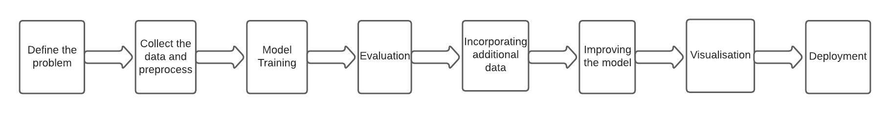

# Zero-Shot Entity Extraction from Healthcare Text Using ChatGPT

This is an academic project proposal from my master's program, written for INFO 5731, Computational Methods for Information Systems, in Spring 2023. A five-person team wrote it as the term project's first deliverable.

The proposal plans to use ChatGPT for zero-shot entity extraction: finding entities such as symptoms, treatments and diseases in healthcare text without task-specific training data. It also plans to compare this approach with traditional supervised methods.

> **Note:** This repository contains a **project proposal only**. It describes planned work. It does not include implementation code, experiments or results.

## Project Overview

Named-entity extraction identifies key items in text and sorts them into predefined categories. Supervised extraction models usually need labeled training data for each entity type. Large language models like ChatGPT can follow instructions in a prompt. This raises the question of whether they can extract entities in a new domain *zero-shot*, meaning without labeled examples or fine-tuning.

The proposal applies this idea to healthcare, a domain where labeled data is expensive to create. It focuses on extracting entities such as **symptoms**, **treatments** and **diseases**.

## Research Questions

1. How does ChatGPT perform on zero-shot entity extraction compared with traditional supervised learning approaches, in terms of accuracy and efficiency?
2. Does performance vary across domains such as health, finance and sports, or with dataset size and diversity?
3. Does adding more data improve the model's performance?
4. How can the model's performance be improved further?

## Objectives

- Develop a zero-shot entity extraction approach that recognizes and classifies entity types it was not explicitly trained on.
- Evaluate it with standard metrics and compare it with existing approaches.
- Explore improvements such as data augmentation and fine-tuning.
- Consider deploying the model as a web service for real-time use.

## My Contribution

The proposal was written by a five-person team. I contributed to:

- **Introduction and research questions:** problem framing, significance, research questions and objectives
- **Methodology:** the plans for model training, evaluation, model improvement and deployment
- **Data plan:** data collection and cleaning, and the experiment and data analysis plan
- **Workflow diagram:** the eight-step project pipeline shown below

## Team

Group 6:

- Sravika Reddy Danda
- Mahitha Poduvu
- Eshwitha Naini
- Manisha Lokasani
- Aliya Yasmin

## Proposed Workflow



| Step | Plan |
|---|---|
| **1. Define the problem** | Choose the entity types to extract from healthcare text. |
| **2. Collect and preprocess data** | Gather healthcare reports, documents or web pages. Clean them with NLTK, pandas and scikit-learn: remove stop words and punctuation, lemmatize, tokenize and vectorize. |
| **3. Model training** | Use OpenAI's ChatGPT through the OpenAI Python library for zero-shot extraction of treatments, symptoms and diseases, with no fine-tuning. |
| **4. Evaluation** | Compare ChatGPT with traditional supervised NER and part-of-speech tagging using accuracy, precision, recall and F1-score. Test across domains (finance, sports, entertainment), dataset sizes and levels of diversity. |
| **5. Incorporate additional data** | Add more healthcare data, and use topic modeling (LDA, LSA, BERTopic) to analyze the data and find relevant topics. |
| **6. Improve the model** | Fine-tune on the healthcare data. Use hyperparameter tuning, regularization, early stopping and transfer learning. |
| **7. Visualization** | Visualize the extracted entities with spaCy and Matplotlib, including entity graphs. |
| **8. Deployment** | Expose the model as a RESTful API for real-time entity extraction in healthcare applications. |

## Proposed Technologies

- **Language:** Python
- **LLM access:** OpenAI Python library (ChatGPT)
- **NLP and preprocessing:** NLTK, spaCy, scikit-learn, pandas
- **Topic modeling:** LDA, LSA, BERTopic
- **Visualization:** Matplotlib, spaCy
- **Evaluation metrics:** accuracy, precision, recall, F1-score

## Status and Limitations

- **Proposal only:** This was the first deliverable of the term project. The repository contains no code, data, experimental results or performance metrics.
- **No dataset chosen:** The proposal does not name a specific healthcare dataset.
- **Phases still open:** The plan starts with zero-shot prompting and then moves to fine-tuning in later steps. The proposal does not settle how those phases would fit together.

## Repository Structure

```
.
├── README.md
├── docs/
│   └── zero-shot-entity-extraction-proposal.docx   # Original proposal (April 9, 2023)
└── images/
    └── proposed-workflow.jpg                       # Workflow diagram from the proposal
```

## Supporting Documents

- [Project proposal (Word)](docs/zero-shot-entity-extraction-proposal.docx). GitHub does not preview `.docx` files, so select **Download raw file** to view it.

## References

These are the references cited in the proposal:

- Van Hoang, N., Mulvad, S. H., Rong, D. N. Y., and Yue, Y. (2021). *Zero-Shot Learning in Named-Entity Recognition with External Knowledge.* arXiv:2111.07734. https://arxiv.org/abs/2111.07734
- shmulvad/zero-for-ner (GitHub). https://github.com/shmulvad/zero-for-ner
- Data Science Stack Exchange, machine-learning tag. https://datascience.stackexchange.com/?tags=machine-learning
- Stack Overflow, "Zero-shot named entity recognition" (question 74616546). This question is no longer publicly available.
